# CI/CD con proyectos de base de datos SQL y GitHub Actions

DP-800 · Implementación de CI/CD

Álvaro García-Quismondo Lizana · Máster en IA y Big Data · Tajamar · 9 de octubre de 2026

## 1. Entorno y base de datos

Git ya estaba instalado (2.49.0). GitHub CLI 2.102.0 y el SDK de .NET 8.0.425 los instalé con winget, y después inicié sesión en GitHub con gh auth login, protocolo HTTPS y autenticación por navegador, con la cuenta alvarophck.

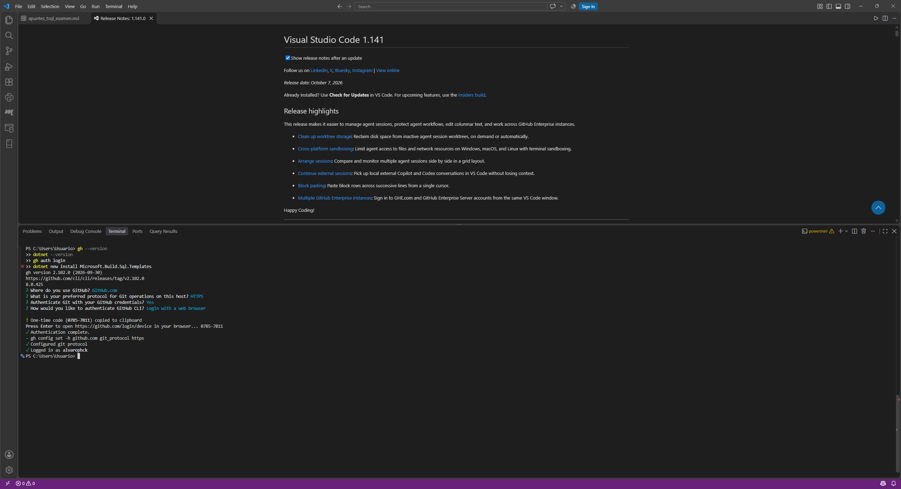

*Figura 1. Versiones de gh y dotnet e inicio de sesión en GitHub.*

No creé una base nueva. Reutilicé AdventureWorksLT del laboratorio anterior, que sigue en el servidor dp800-lab06 dentro del grupo de recursos rg-dp800-lab06. El servidor usa solo autenticación de Microsoft Entra, así que en el enunciado me correspondía la opción B.

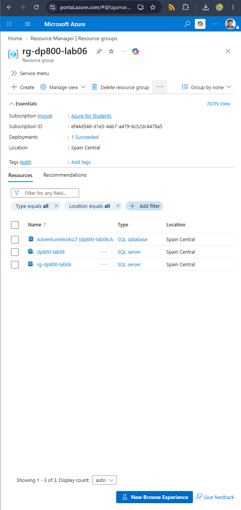

*Figura 2. Grupo de recursos con la base de datos y los servidores.*

## 2. Proyecto de base de datos

Creé la carpeta AdventureWorksDB y el proyecto con dotnet new sqlproj -tp SqlAzureV12, para que el dacpac sea compatible con Azure SQL Database. Dentro añadí la tabla dbo.InventoryLog en Tables y el procedimiento dbo.uspLogInventoryChange en StoredProcedures, con el contenido del enunciado.

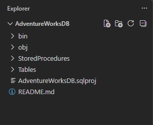

*Figura 3. Estructura del proyecto en VS Code.*

La compilación local terminó sin advertencias ni errores y generó AdventureWorksDB.dacpac en bin/Debug.

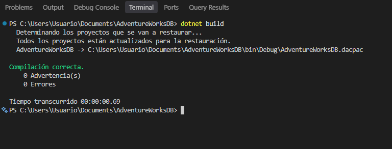

*Figura 4. Resultado de dotnet build.*

## 3. Identidad de despliegue en Entra

Registré una aplicación llamada sqldeploysp en Microsoft Entra ID y le añadí una credencial federada para que GitHub Actions pueda autenticarse sin contraseña. La captura muestra la credencial tal y como la creó el portal con la plantilla de GitHub Actions; más adelante tuve que recrearla (apartado 5).

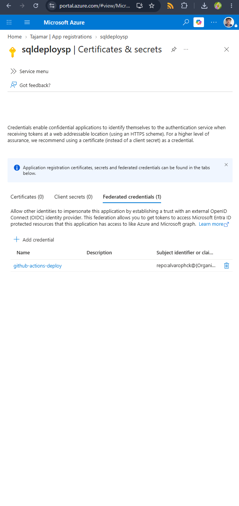

*Figura 5. Credencial federada github-actions-deploy en la aplicación sqldeploysp.*

Después asigné el rol SQL Server Contributor a la aplicación sobre el grupo de recursos y creé su usuario en la base de datos. En el tenant hay más aplicaciones con el nombre sqldeploysp, por lo que CREATE USER ... FROM EXTERNAL PROVIDER falló con el error 33131 (nombre duplicado). Lo resolví con WITH OBJECT_ID, usando el identificador del service principal de mi aplicación. Eso me obligó a repetir también la asignación del rol, porque la primera vez había elegido por nombre y no era la mía.

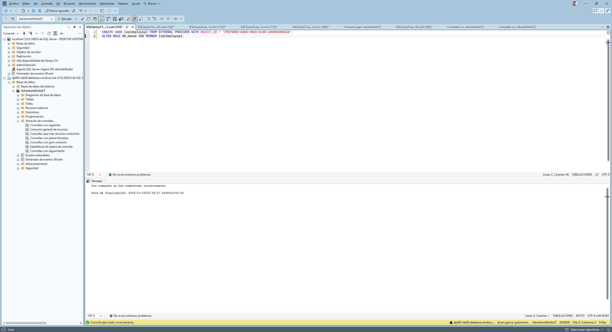

*Figura 6. Creación del usuario con WITH OBJECT_ID y pertenencia a db_owner.*

## 4. Repositorio, secretos y workflow

Inicié el repositorio con git init -b main, añadí un .gitignore con bin/ y obj/ y creé el repositorio privado alvarophck/AdventureWorksDB con gh repo create. Los cuatro secretos (AZURE_CLIENT_ID, AZURE_TENANT_ID, AZURE_SUBSCRIPTION_ID y SQL_CONNECTION_STRING) los guardé con gh secret set. La cadena de conexión usa Authentication=Active Directory Default, sin contraseña.

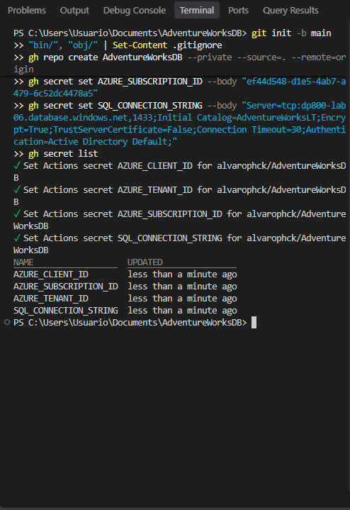

*Figura 7. Creación del repositorio y secretos registrados.*

El workflow build-deploy.yml es el de la variante B: compila el proyecto, instala SqlPackage, inicia sesión en Azure con azure/login y publica el dacpac con azure/sql-action. Lo creé desde la terminal y subí el primer commit a main.

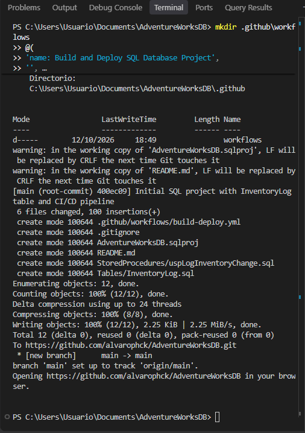

*Figura 8. Creación del workflow y primer commit.*

## 5. Primer despliegue

La primera ejecución falló en el paso Azure Login, después de que pasaran el build y la instalación de SqlPackage. Hubo dos causas, una detrás de otra. La primera fue AADSTS700016: el valor del secreto AZURE_CLIENT_ID no correspondía a ninguna aplicación del tenant, y lo corregí con el Application (client) ID. La segunda fue AADSTS700213: el subject que presenta GitHub tiene el formato repo:alvarophck@185831094/AdventureWorksDB@1415861486:ref:refs/heads/main, con los identificadores numéricos de la organización y del repositorio, y la credencial del portal no coincidía. La recreé como Other issuer con ese subject explícito.

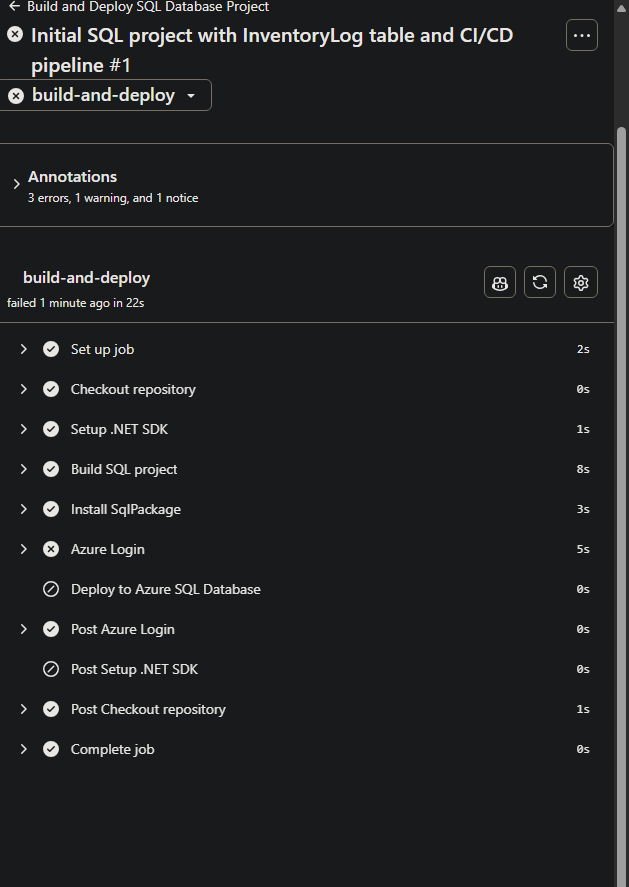

*Figura 9. Primera ejecución, con el fallo en Azure Login.*

Tras relanzar la ejecución terminó correctamente en 1 min 44 s. En la base de datos aparecen la tabla y el procedimiento, que antes no existían.

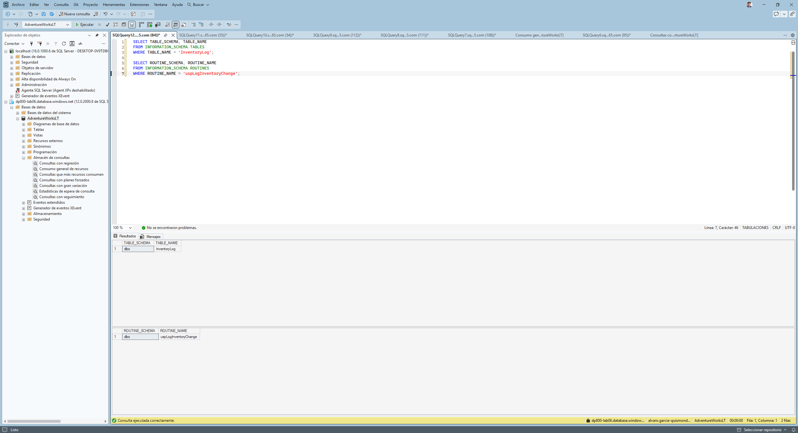

*Figura 10. Tabla InventoryLog y procedimiento uspLogInventoryChange creados por el pipeline.*

## 6. Cambio de esquema

Para probar el ciclo completo añadí la columna Notes NVARCHAR(200) NULL a la definición de la tabla, compilé en local y subí el cambio con un commit nuevo.

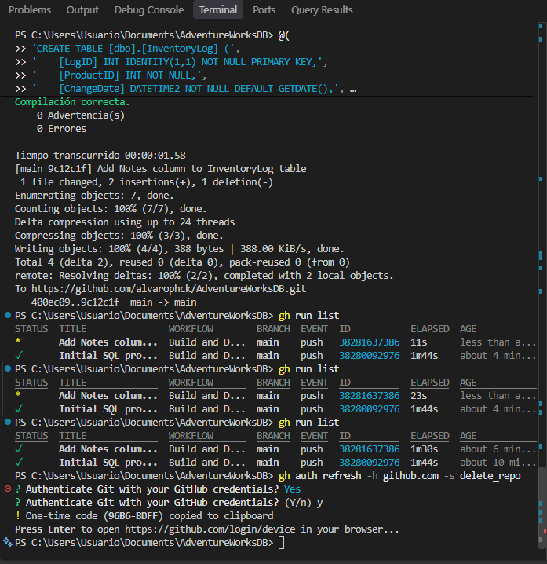

*Figura 11. Compilación, commit y push del cambio.*

La segunda ejecución del workflow terminó en verde en 1 min 30 s.

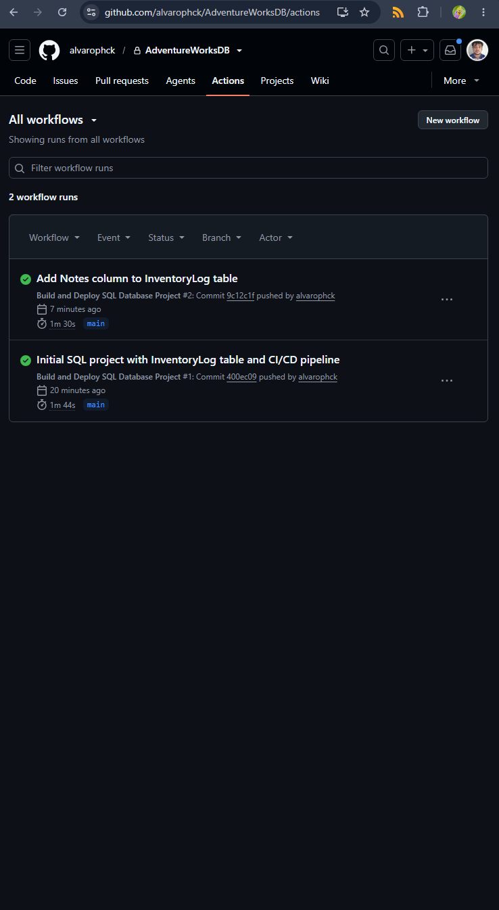

*Figura 12. Las dos ejecuciones del workflow en Actions.*

La consulta sobre INFORMATION_SCHEMA.COLUMNS muestra la columna Notes de tipo nvarchar y admite nulos. No escribí ningún ALTER TABLE: lo generó el despliegue al comparar el dacpac con la base.

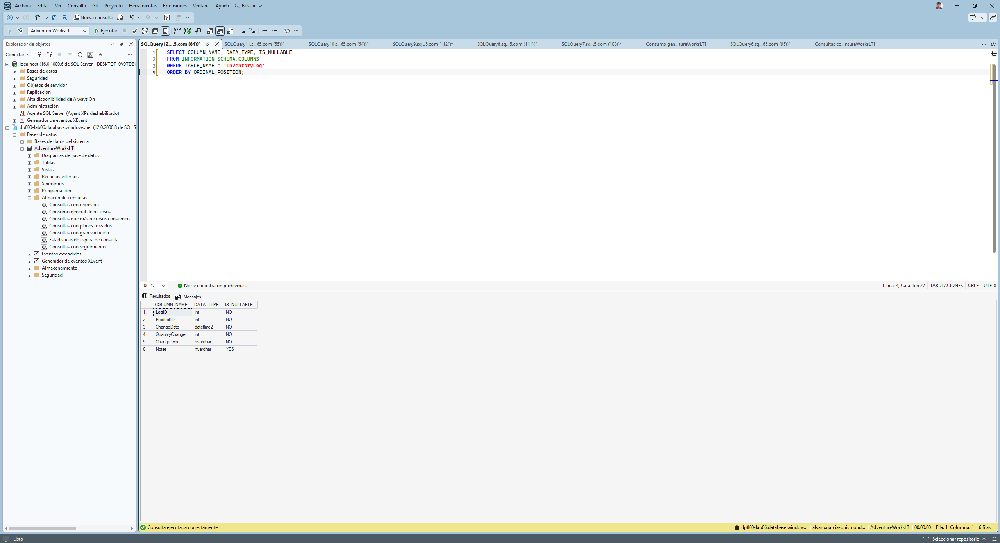

*Figura 13. Columnas de InventoryLog tras el segundo despliegue.*

## 7. Limpieza

Para borrar el repositorio con gh repo delete tuve que ampliar antes el permiso del token con gh auth refresh -s delete_repo, porque la primera vez devolvió un 403.

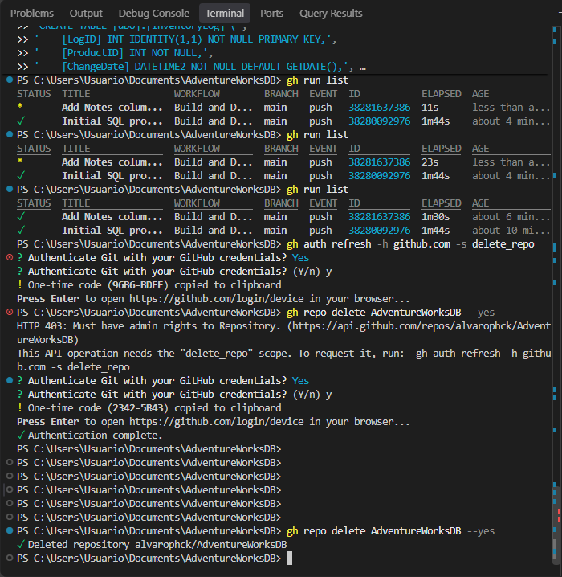

*Figura 14. Borrado del repositorio.*

Los ficheros del proyecto, el workflow y los scripts SQL están en las carpetas proyecto y sql del zip.
